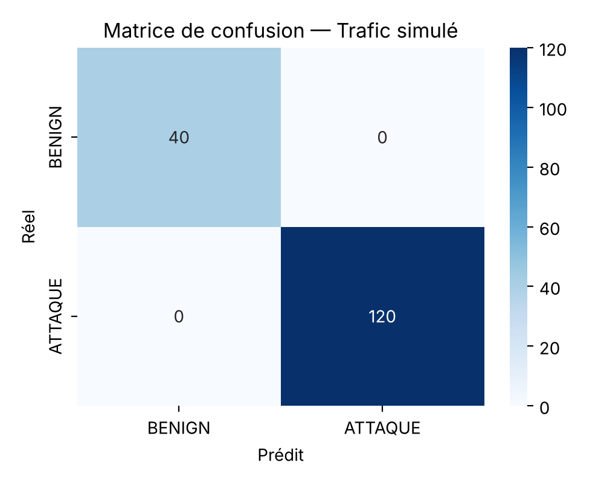
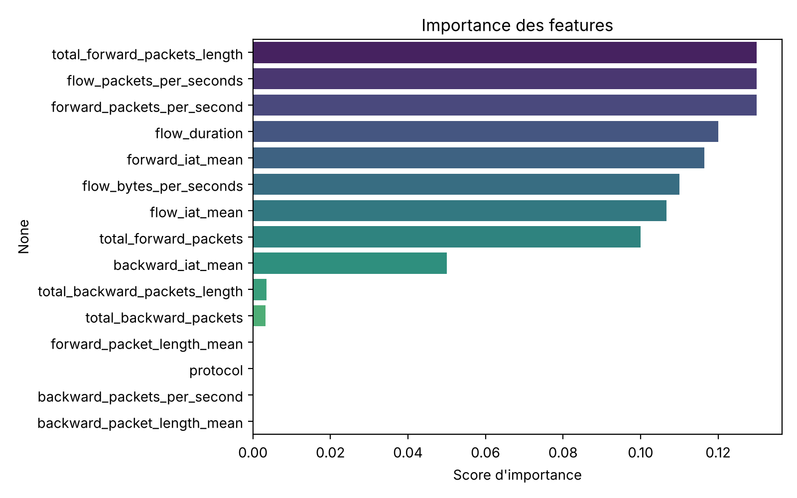

# Détection d'attaques DDoS par Random Forest (simulation + temps réel)

**Résumé (EN):** a small end-to-end DDoS detection prototype. It simulates network flows (benign, SYN flood, UDP flood, HTTP flood), trains a Random Forest, and runs a real-time monitor (Scapy sniffing + Rich terminal dashboard) on the loopback interface of a Kali Linux VM. Course project, Cybersecurity & Cryptography, ENSI. The data is synthetic: perfect test scores are expected and do **not** measure real-world performance (see Limits).

Projet du cours *Cybersécurité & Cryptographie* (ENSI, 2025-2026).

## Ce que fait le projet

1. **Simulation** (`simulate.py`) : génère 800 flux réseau étiquetés (200 trafic normal, 200 SYN flood, 200 UDP flood, 200 HTTP flood), décrits par 15 caractéristiques (débit de paquets, durée du flux, taille moyenne des paquets, intervalles entre paquets, etc.).
2. **Évaluation** (`detection.py`) : entraîne un Random Forest (100 arbres, normalisation `StandardScaler`, découpage 80/20 stratifié), classe *normal* contre *attaque*, et produit la matrice de confusion et l'importance des variables.
3. **Calibration** (`calibrate.py`) : régénère 2 000 flux dont les caractéristiques sont calculées **comme le fait le moniteur** (durées en secondes, débits en paquets/s), puis entraîne le modèle utilisé en direct.
4. **Détection en temps réel** (`monitor.py`) : capture les paquets avec Scapy sur l'interface `lo`, calcule les caractéristiques sur une fenêtre de 2 secondes, prédit avec le modèle et affiche un tableau de bord Rich (statut, confiance, historique horodaté des alertes).
5. **Génération de trafic** : `attack.py` envoie de vrais paquets (SYN, UDP, HTTP) vers `127.0.0.1` ; `normal_traffic.py` produit un trafic de fond lent.

## Résultats

| Étape | Jeu de test | Résultat |
|---|---|---|
| `detection.py` (800 flux simulés) | 160 flux (40 normaux, 120 attaques) | 0 erreur |
| `calibrate.py` (2 000 flux simulés) | 400 flux (100 normaux, 300 attaques) | 0 erreur |



Variables les plus discriminantes : volume d'octets envoyés, débit de paquets du flux et débit d'envoi, durée du flux.



Lors de la démonstration sur Kali Linux, les trois types d'attaques ont été signalés en moins de 2 secondes, avec une confiance du modèle comprise entre 60 % et 82 % (valeurs relevées à la main pendant la démo ; elles ne sont pas reproduites automatiquement par ce dépôt).

## Limites (à lire avant d'interpréter les scores)

- **Les données sont synthétiques** : les plages de valeurs de chaque classe sont volontairement très différentes, donc 100 % de précision est attendu et ne dit rien de la performance sur du trafic réel.
- Le modèle ne fait que **normal / attaque** ; il ne distingue pas le type d'attaque.
- La confiance plus basse en direct (60-82 %) montre l'écart entre le trafic simulé et le trafic réellement capturé.
- Les attaques sont émises sur la boucle locale uniquement : elles n'ont pas la nature distribuée d'un vrai DDoS.
- Une première version utilisait un échantillon du jeu **CICDDoS2019** (attaque DrDoS DNS). Ses variables ne correspondaient pas à celles calculées par le moniteur, ce qui a conduit à générer des données synthétiques au même format. Piste d'amélioration : entraîner sur du trafic réel au format du moniteur.

## Installation et utilisation

```bash
git clone https://github.com/Lyna-Kamoun/detection-attaques-ddos.git
cd detection-attaques-ddos
pip install -r requirements.txt
cd src
```

**Entraînement et évaluation** (fonctionne sous Windows, Linux, macOS) :

```bash
python simulate.py     # génère data/trafic_simule.csv
python detection.py    # évaluation + figures dans data/
python calibrate.py    # entraîne le modèle final dans models/ (écrase celui de detection.py)
```

**Démo en temps réel** (Linux, droits root requis, testée sous Kali Linux dans une VM) dans trois terminaux, depuis `src/` :

```bash
sudo python3 monitor.py          # terminal 1 : tableau de bord
python3 normal_traffic.py        # terminal 2 : trafic normal
sudo python3 attack.py           # terminal 3 : choisir 1 (SYN), 2 (UDP) ou 3 (HTTP)
```

> **Avertissement :** `attack.py` ne doit être utilisé que sur la boucle locale (`127.0.0.1`) de votre propre machine ou d'une VM de test. Envoyer ce type de trafic vers un système qui ne vous appartient pas est illégal.

## Structure

```
src/        simulate.py, detection.py, calibrate.py, monitor.py, attack.py, normal_traffic.py
data/       trafic_simule.csv (généré), figures
models/     modèles générés par calibrate.py (non versionnés)
```

## Auteure

Lyna Kamoun, élève ingénieure en 3ᵉ année, ENSI (filière Finance).
